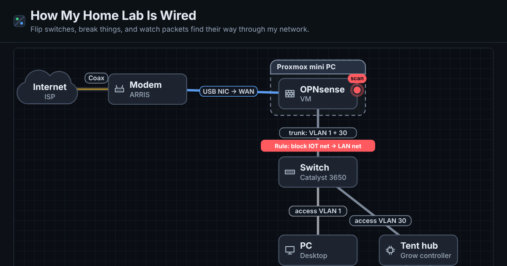
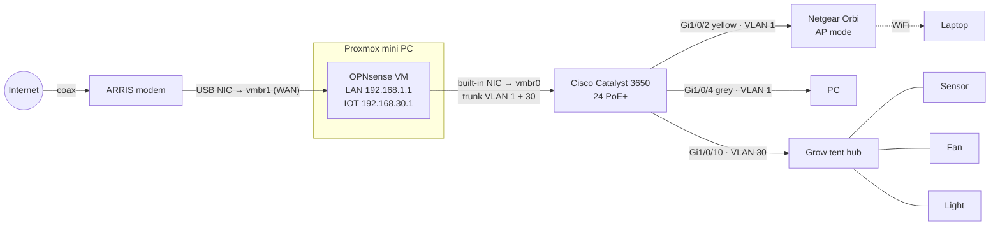

# How My Home Lab Is Wired

An interactive explainer of my real home lab network: flip switches, break things, and watch packets find their way from my desk to the internet.

**Live demo:** https://homelab-explainer.vercel.app

[](https://homelab-explainer.vercel.app)

Instead of reading a static diagram, you change one thing at a time (unplug a cable, flip the Orbi into router mode, turn on the IoT VLAN) and watch packets travel, get NATed, or get stopped by a firewall rule. Click any device for what it is, why it sits where it does, and the real OPNsense, Cisco IOS XE and Proxmox config behind it.

## What it covers

| # | Lesson | What you learn |
|---|---|---|
| 1 | **The core path** | Follow a packet from the PC through the switch, OPNsense and the modem to the internet, and see where NAT happens. |
| 2 | **The Orbi is down** | The yellow cable's link is down; work through layer 1 and layer 2 checks (cable, `shutdown`, err-disabled, wrong VLAN) to find out why. |
| 3 | **Double NAT** | Flip the Orbi from AP mode to router mode and see the second NAT and second subnet that appear. |
| 4 | **IoT VLAN** | Put the grow tent on VLAN 30 and watch OPNsense allow DNS and internet but block the LAN. |

## The real hardware

| Device | Role |
|---|---|
| **ARRIS cable modem** | Pure modem (no routing); hands the public IP to OPNsense. |
| **OPNsense VM on Proxmox** | Firewall, router, NAT, DHCP and DNS. Runs on a mini PC: a **USB NIC** is the WAN bridge (`vmbr1`), the **built-in NIC** is the LAN bridge (`vmbr0`). |
| **Cisco Catalyst 3650 24 PoE+** | Core switch. `Gi1/0/1` is an 802.1Q trunk to OPNsense carrying VLAN 1 (LAN) and VLAN 30 (IoT). |
| **Netgear Orbi** | WiFi in AP mode on `Gi1/0/2` (the yellow cable), so there is one network and one NAT. |
| **PC** | Wired client on `Gi1/0/4` (the grey cable), `192.168.1.50`. |
| **Grow tent IoT** | Controller hub plus sensor, fan and light on **VLAN 30** (`192.168.30.0/24`), isolated from the LAN. |



> The WAN address shown in the app (`203.0.113.45`) is from an RFC 5737 documentation range; passwords and MACs in config snippets are placeholders.

## How it's built

- **Vite + TypeScript, no framework.** The UI is built with plain DOM APIs (`createElement`), which also keeps the strict CSP happy.
- **SVG stage.** `src/stage/` renders the topology from `src/topology.ts` and animates packets along links, with NAT badges and block markers.
- **Declarative lessons.** Each lesson is a plain object: its `params` (toggles and choices), `actions` (buttons like "Ping"), and a pure `solve(state)` function that returns link states, node states, packet flows and a status line. Lessons never touch the DOM; the stage just animates whatever `solve()` returns.

```
src/types.ts      shared contract: topology, Lesson, SolveResult, Stage
src/topology.ts   node positions, links (cables, ports, colours), frames
src/stage/        SVG renderer and packet animation
src/lessons/      one Lesson per file, ordered in index.ts
src/content/      device panel text and real config snippets
src/ui/           lesson list, controls, status bar, device panel
```

### Adding a lesson

1. Create `src/lessons/my-lesson.ts` exporting a `Lesson`:

   ```ts
   export const myLesson: Lesson = {
     id: 'pc-ping',
     title: 'Ping the gateway',
     intro: 'The PC pings OPNsense at 192.168.1.1.',
     params: [{ id: 'grey', type: 'toggle', label: 'Grey cable', default: true }],
     actions: [{ id: 'ping', label: 'Ping 192.168.1.1' }],
     solve({ params, action }) {
       const up = params.grey === true;
       return {
         links: { grey: up ? 'up' : 'down' },
         flows: action === 'ping'
           ? [up
               ? { path: ['pc', 'switch', 'opnsense'], verdict: 'allow', label: 'ping' }
               : { path: ['pc'], verdict: 'block', label: 'ping', reason: 'No link on Gi1/0/4' }]
           : [],
         status: up ? 'The PC has a link on Gi1/0/4.' : 'Gi1/0/4 is notconnect.',
       };
     },
   };
   ```

2. Add it to the array in `src/lessons/index.ts`.
3. Flow paths must follow links that exist in `src/topology.ts`; pull configs from `src/content/snippets.ts` by key.

## Run locally

```sh
npm install
npm run dev     # dev server with hot reload
npm run build   # typecheck + production build into dist/
```

## Deploy

Hosted on **Vercel**, configured in `vercel.json`:

- Framework Preset: **Vite**
- Build command: `npm run build`
- Output directory: `dist`

Vercel auto-deploys production whenever `main` is updated; pull requests get preview URLs.

## Security

Even a static site gets real response headers, set in `vercel.json` for every route:

| Header | Value | Why |
|---|---|---|
| `Content-Security-Policy` | `default-src 'self'; script-src 'self'; style-src 'self'; img-src 'self' data:; font-src 'self'; base-uri 'self'; form-action 'none'; frame-ancestors 'none'` | Only first-party scripts and styles can run (no inline code, no third-party CDNs), so injected markup can't execute. `frame-ancestors 'none'` blocks clickjacking. |
| `X-Content-Type-Options` | `nosniff` | Browsers must honour the declared content type instead of guessing, so a file can't be reinterpreted as script. |
| `Referrer-Policy` | `strict-origin-when-cross-origin` | Other sites only see the origin, never full URLs, and nothing leaks over a downgrade to HTTP. |

Hashed build files under `/assets/*` are also served with a one-year `immutable` cache.

## What I learned

- **Segmentation is a firewall decision, not a switch decision.** The VLAN only separates traffic; the OPNsense rule order (allow DNS, block LAN net, allow internet) is what actually keeps the grow tent away from my PC.
- **Double NAT hides in default settings.** The Orbi ships in router mode, which quietly adds a second subnet and NAT; switching it to AP mode gave me one clean network.
- **Firewall rules are first match wins.** Putting the "block IOT → LAN" rule above the "allow any" rule is the whole difference between isolated and wide open.
- **Documenting as I build pays off.** Turning my configs into lessons forced me to understand every line, and caught real mistakes (like `ip default-gateway` doing nothing while `ip routing` was on).
