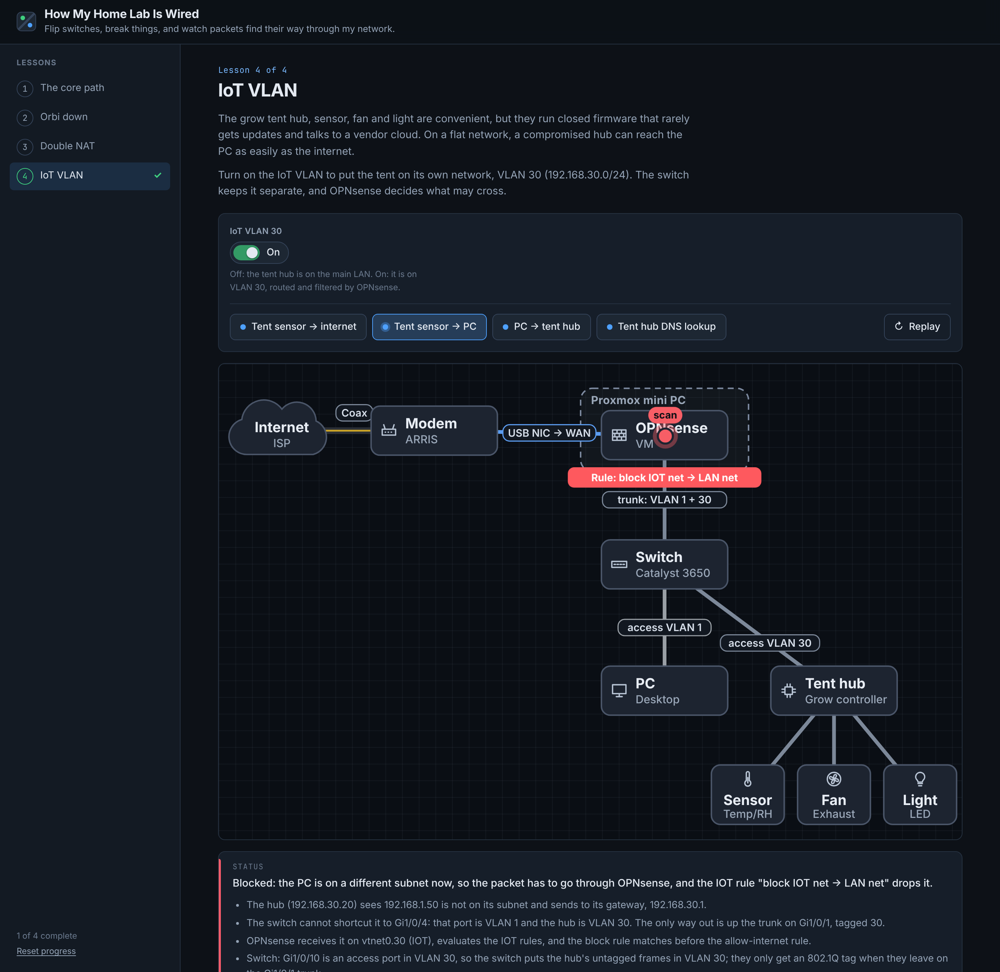
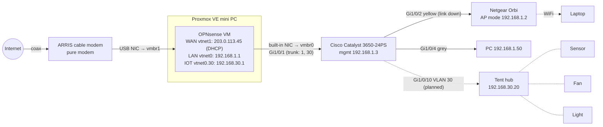

# Home Lab Network Explainer

An interactive, in-browser explainer of a real home lab network. Instead of reading a
diagram, you flip switches (unplug the yellow cable, put the Orbi in router mode, turn
on the IoT VLAN) and watch packets travel from the PC, laptop and grow tent out to the
internet, get NATed, or get stopped by a firewall rule. Every device has a side panel
with the real OPNsense, Cisco IOS XE and Proxmox configs behind it. Modeled after the
"How It's Wired" style of explainers: one picture, one change at a time.



## The network



## IP plan

| Network / device | Address | Notes |
|---|---|---|
| WAN (OPNsense `vtnet1`) | `203.0.113.45` | ISP DHCP; documentation example, not the real IP |
| LAN | `192.168.1.0/24` | VLAN 1, untagged on the trunk |
| OPNsense LAN (`vtnet0`) | `192.168.1.1` | Gateway, DHCP, DNS |
| Orbi (AP mode) | `192.168.1.2` | DHCP reservation. In router mode this is its WAN, with its own LAN `10.0.0.0/24` (gw `10.0.0.1`) |
| Catalyst 3650 (`Vlan1`) | `192.168.1.3` | Switch management SVI |
| Proxmox host (`vmbr0`) | `192.168.1.10` | Management only; no IP on `vmbr1` (WAN) |
| PC | `192.168.1.50` | `Gi1/0/4` (grey cable) |
| IOT (VLAN 30, planned) | `192.168.30.0/24` | Gateway `192.168.30.1` on OPNsense; DHCP pool `.100`-`.200` |
| Tent hub | `192.168.30.20` | `Gi1/0/10`, DHCP reservation |

## Lessons

1. **The core path**: follow a packet from the PC through the switch, OPNsense and the modem to the internet, and see where NAT happens.
2. **The Orbi is down**: the yellow cable's link on `Gi1/0/2` is down; work through layer 1 to layer 2 checks to find out why.
3. **Double NAT**: compare the Orbi in router mode (two NATs, two subnets) with AP mode (one network).
4. **IoT VLAN**: put the grow tent on VLAN 30 and watch OPNsense allow DNS and internet but block the LAN.

## Run locally

```sh
npm install
npm run dev       # dev server with hot reload
npm run build     # typecheck + production build into dist/
npm run preview   # serve the built dist/ locally
```

## Project structure

```
src/types.ts          the shared contract: topology, lesson, solve result and Stage types
src/topology.ts       node positions, links (cables, ports, colours) and frames
src/stage/            SVG renderer and packet animation engine
src/lessons/          one declarative Lesson object per file, plus index.ts (order)
src/content/          devices.ts (side panel text) and snippets.ts (real configs)
src/ui/               lesson list, controls, status bar, device panel
src/main.ts           wires the shell, stage and lessons together
```

A lesson never touches the DOM. It declares its params and actions, and `solve()` turns
the current state into links, node states and packet flows; the stage animates them.

## How to add a lesson

1. Create `src/lessons/my-lesson.ts`:

```ts
import type { Lesson } from '../types';
import { snippets } from '../content/snippets';

export const myLesson: Lesson = {
  id: 'pc-ping',
  title: 'Ping the gateway',
  intro: 'The PC pings OPNsense at 192.168.1.1.\n\nUnplug the grey cable and try again.',
  params: [
    { id: 'grey', type: 'toggle', label: 'Grey cable', default: true, onLabel: 'Plugged in', offLabel: 'Unplugged' },
  ],
  actions: [{ id: 'ping', label: 'Ping 192.168.1.1' }],
  solve({ params, action }) {
    const up = params.grey === true;
    return {
      links: { grey: up ? 'up' : 'down' },
      flows:
        action === 'ping'
          ? [up
              ? { path: ['pc', 'switch', 'opnsense'], verdict: 'allow', label: 'ping' }
              : { path: ['pc'], verdict: 'block', label: 'ping', reason: 'No link on Gi1/0/4' }]
          : [],
      status: up ? 'The PC has a link on Gi1/0/4.' : 'Gi1/0/4 is notconnect.',
    };
  },
  deviceNotes: {
    switch: { body: 'Gi1/0/4 is a plain access port.', snippets: [snippets.iosPcPort] },
  },
};
```

2. Add it to the array in `src/lessons/index.ts`. Flow paths must follow links that exist
   in `src/topology.ts`, and configs should come from `src/content/snippets.ts` by key.

## Deploy to Vercel

`vercel.json` already sets the framework (Vite), build command (`npm run build`) and
output directory (`dist`), so either route works with no extra settings.

**Dashboard**: push the repo to GitHub, then in Vercel choose *Add New ▸ Project*,
import the repository, keep the framework preset **Vite**, build command
`npm run build`, output directory `dist`, and deploy. Every push to the default branch
redeploys; pull requests get preview URLs.

**CLI**:

```sh
npm i -g vercel
vercel          # link the project and create a preview deployment
vercel --prod   # deploy to production
```

## Accuracy notes

- `203.0.113.0/24` is an RFC 5737 documentation range; the real WAN IP is not published.
- NIC names (`enp1s0`, `enx<mac>`) are examples; check yours with `ip -br link`.
  OPNsense also names VLAN devices itself (`vlan01`, `vtnet0_vlan30`, depending on version);
  the explainer calls it `vtnet0.30`.
- OPNsense menu paths are for 24.x/25.x (e.g. VLANs under *Interfaces ▸ Devices ▸ VLAN*,
  formerly *Interfaces ▸ Other Types ▸ VLAN*). DHCP may be ISC, Kea or Dnsmasq depending on
  version and choice.
- Switch configs are IOS XE syntax for the Catalyst 3650; the 3650 is 802.1Q only, so there
  is no `switchport trunk encapsulation` command.
- Passwords and MACs in snippets are placeholders.
